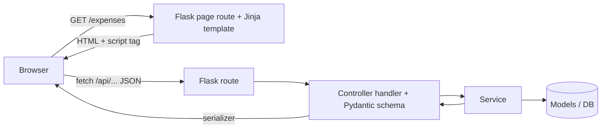
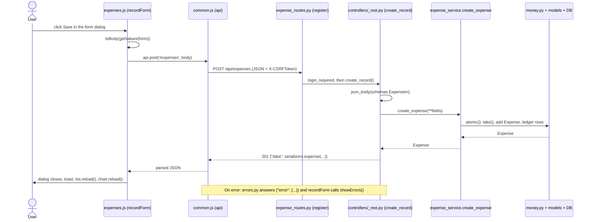

# Be Aware: maintenance and architecture guide

This guide describes the code as it is today. Where something could not be confirmed from the source, it says so. File paths are relative to the project root (the folder that contains `run.py`).

## 1. Project overview

**Purpose.** Be Aware is a single-user personal finance tracker. It records expenses, incomes, withdrawals, deposits, loans, debts, bank transfers and credit card payments, keeps the balances of bank accounts and credit cards in step with them, and keeps three ledgers (cash, bank account, credit card). The home page shows totals and yearly charts.

**Technologies**

| Layer | What is used (from `requirements/requirements.txt` and the code) |
|---|---|
| Backend | Python, Flask, Flask-SQLAlchemy, Flask-Login, Flask-WTF (CSRF), Flask-Limiter, Flask-Migrate, Flask-Babel, Pydantic (request validation), bcrypt |
| Database | SQLite for development and tests, MySQL for production (`app/config.py`) |
| Templates | Jinja2 (`app/templates`) |
| Styling | Tailwind CSS 3.4, built from `frontend/` into `app/static/css/app.css` |
| Frontend code | Plain ES modules in `app/static/js` (no bundler), Chart.js (`app/static/vendor/chart.umd.js`), a Lucide icon sprite (`app/static/img/icons.svg`) |

**Architecture in one paragraph.** There are two kinds of requests. (1) A browser opens a **page** (`GET /expenses`): Flask renders a Jinja template that contains the real HTML (table header, row template, form dialog) but **no records**. (2) The page's script (`app/static/js/expenses.js`) then calls the **JSON API** under `/api` (`GET /api/expenses`) and fills the page with `textContent`. All saving, editing and deleting goes through `/api` as JSON. There is no page that posts an HTML form.



Backend layering is always `route -> controller -> service -> model`. Tailwind is only a build step: it scans the templates and scripts for class names and writes one CSS file.

**Legacy notes (verified by searching the code).** The project was refactored, and some old code is still present:

- `to_dict()` on the models (for example `app/models/expense.py`) is no longer what JSON responses use; the controllers use `app/controllers/serializers.py`. `to_dict()` is still called by `app/services/associations.py` (`group_by_table`) and by a few `associated_records` helpers.
- No caller was found, in `app/` or `tests/`, for these functions (searched by name; dynamic use cannot be ruled out): `associated_records_page` and `associated_records` in `app/services/bank_account_service.py`, `associated_records` in `app/services/credit_card_service.py`, `app/services/loan_service.py` and `app/services/debt_service.py`, `get_data_as_dictionary` in `app/utils/parse_structures.py`, and `is_decimal_type` in `app/utils/numeric_casting.py`. `expense_category_service.associated_records` is still called by `records_of` in `app/controllers/expense_category_controller.py`, only to produce a 404 for a deleted category.
- `app/templates/layout.html` still loads `static/vendor/flatpickr.min.js` and `.css`, but no current page or script uses a date picker (the forms use native `datetime-local` and `date` inputs).
- Some file and blueprint names do not match the URLs any more: `app/routes/banktransfer_routes.py` serves `/api/bank_transfers`, `app/routes/cashledger_routes.py` serves `/cash_ledger`, `app/routes/bank_transaction_ledger_routes.py` serves `/bank_ledger`, `app/routes/credit_card_transaction_routes.py` serves `/card_ledger`.
- Spelling quirks that are part of the code: the CSRF extension is called `crsf` in `app/extensions.py`, `generate_montly_sequence` in `app/utils/code_generator.py`, and the user-facing message `Insufficient founds.` in `app/services/money.py`.

## 2. Project directory structure

```
be_aware/
├── run.py, wsgi.py              entry points: both call create_app()
├── pytest.ini                   testpaths = tests
├── requirements/                requirements.txt, requirements-dev.txt
├── README.md                    setup and URL summary
├── MAINTENANCE_GUIDE.md         this file
├── app/
│   ├── __init__.py              create_app(), extension setup, blueprint registration, error log files
│   ├── config.py                Config, DevelopmentConfig, TestingConfig, ProductionConfig, get_config()
│   ├── extensions.py            db, babel, limiter, login_manager, crsf (CSRFProtect)
│   ├── cli.py                   `flask init-db`, `flask seed-db`
│   ├── errors.py                one JSON error format + handlers + unauthorized()
│   ├── routes/                  URL -> handler. One <module>_routes.py per module; _rest.py has register() and get()
│   ├── controllers/             request -> service call -> JSON. _rest.py (Resource, handlers), schemas.py, serializers.py
│   ├── services/                business rules, no Flask: <module>_service.py, money.py, search.py, ledger_service.py, stats_service.py
│   ├── models/                  SQLAlchemy models, one file per table; __init__.py imports them all
│   ├── exceptions/              domain exceptions (bankProductsException.py, records.py, generic.py)
│   ├── utils/                   transactions.py (atomic), times.py, date_handling.py, code_generator.py, filter_data.py, auth.py, db.py
│   ├── templates/               layout.html, one <page>.html per page, partials/, auth/login.html
│   └── static/
│       ├── js/                  common.js (shared), chart.js, forms.js, records.js, app.js, one <page>.js per page
│       ├── css/app.css          GENERATED by Tailwind (committed)
│       ├── img/icons.svg        GENERATED icon sprite (committed)
│       └── vendor/              chart.umd.js, flatpickr (flatpickr is not used by pages)
├── frontend/                    Tailwind source: tailwind.config.js, src/app.css, package.json, scripts/build-icons.mjs
├── tests/                       pytest suite: conftest.py, helpers.py, test_*.py
└── prototypes/                  a design prototype, not part of the app (not inspected)
```

Created at runtime and not part of the source: `instance/` (the development SQLite file `be_aware_dev.db`), `logs/` (`error.log`, `app.log`, written by `create_error_logger` in `app/__init__.py` unless `LOG_TO_FILES` is false). The `.gitignore` file was not inspected for this guide.

## 3. Backend architecture

### 3.1 Startup and configuration

- `run.py` and `wsgi.py` call `create_app()` (`app/__init__.py`). `create_app(config_name=None)` calls `get_config()`, loads the config object, creates `instance/`, wraps the app in `ProxyFix`, then calls `register_extensions(app)`, `register_resources(app)`, `register_cli(app)` and `create_error_logger(app)`.
- `get_config()` in `app/config.py` picks the class from the `APP_ENV` variable (`development` by default, `testing`, `production`). Other variables read: `SECRET_KEY`, `DEV_DATABASE_URL`, `TEST_DATABASE_URL`, `NAV_BAR_BACKGROUND_COLOR`. A `.env` file is loaded with `load_dotenv()`.
- Development uses `instance/be_aware_dev.db` (SQLite). `TestingConfig` uses in-memory SQLite and turns off rate limiting and CSRF. `ProductionConfig.SQLALCHEMY_DATABASE_URI` imports `db_url` from `app/utils/db.py` (MySQL connection built from `.env`). Earlier analysis of this project flagged credentials in the git history (commit `3d66a65`); that cannot be verified from the working tree.
- `inject_theme` (context processor in `create_app`) gives every template `env_name`, `env_label` (the DEV/TEST/PROD badge) and `nav_bar_backgroud`.
- `Migrate(app, db)` is created in `register_extensions`, but **no `migrations/` directory exists in the project**, so schema changes are not managed by migrations (see 8.1).

### 3.2 Blueprints and routes

Each module has one blueprint in `app/routes/<module>_routes.py`, registered in `register_resources` (`app/__init__.py`). The blueprints have no `url_prefix`; every rule is written in full.

- **Pages** are plain `@bp.get('/expenses')` functions that call `render_template('expenses.html', nav='expenses')`. Pages with a record page also have `show(record_id)` (for example `/loans/<id>` renders `loan.html` with `id=record_id`).
- **JSON** is registered with two helpers in `app/routes/_rest.py`:
  - `register(blueprint, resource, path)` adds `GET/POST /api<path>` and `GET/PUT/DELETE /api<path>/<id>`, only for the verbs the `Resource` supports.
  - `get(blueprint, path, view, name)` adds one read-only `GET /api<path>` (used for reports, records and payments).
  - Both wrap the view in `login_required`.
- Auth routes are in `app/routes/auth_routes.py` (`/login` page, `POST /api/login`, `POST /api/logout`, `GET /api/session`). `app/routes/home_routes.py` serves `/`, `/api/dashboard`, `/api/options`. `app/routes/stats_routes.py` serves `/api/reports/...`.

To list every route: `flask routes` (or print `app.url_map`). At the time of writing there were 22 page routes and 101 JSON routes.

### 3.3 Controllers (`app/controllers`)

A controller module declares a `RESOURCE = Resource(...)` (dataclass in `app/controllers/_rest.py`): the model, the serializer function, the create/update schemas, the service functions (`create`, `update`, `delete`), `default_list` (what `GET /api/x` returns with no filter), `filter` (used when `q`, or both `start` and `end`, are given) and `list_meta` (extra values for `meta`). `handlers(resource)` builds the five view functions `list_records`, `create_record`, `read_record`, `update_record`, `delete_record`, so most modules need no hand-written HTTP code. Modules with extras add plain functions, for example `records_of`, `yearly_report` in `app/controllers/bank_account_controller.py`, `payments_of` in `app/controllers/loan_controller.py`.

Other files: `app/controllers/schemas.py` (Pydantic request models), `app/controllers/serializers.py` (response shapes), `app/controllers/home_controller.py` (`dashboard`, `options`), `app/controllers/stats_controller.py` (reports), `app/controllers/auth_controller.py` (`login`, `logout`, `session_info`), `app/controllers/cashledger_controller.py` (the three ledgers: `CASH`, `BANK`, `CARD`).

### 3.4 Services (`app/services`)

Business rules live here. Services take plain keyword arguments (note the `*` in signatures such as `create_expense(*, amount, is_cash, ...)`), return model objects, and know nothing about Flask. Every function that moves money runs inside `with atomic():` (`app/utils/transactions.py`), so the record, the balance change and the ledger rows are committed together or rolled back together.

| File | Responsibility |
|---|---|
| `app/services/money.py` | `validate_amount`, `get_record` (raises `RecordNotFound`), `get_bank_account`, `get_credit_card`, `take` / `give` (move money, refuse to go below zero). Never commits |
| `app/services/<module>_service.py` | `create_*`, `update_*`, `delete_*`, list and filter functions for one module (expense, income, withdrawal, deposit, loan, debt, loan_payment, debt_payment, banktransfer, credit_card_payment, bank, bank_account, credit_card, expense_category) |
| `app/services/search.py` | `SearchSpec` plus `search`, `between_dates`, `filter_all`: the one implementation of the search box and date range on every list |
| `app/services/ledger_service.py` | reading the ledgers, cash adjustments (`create_cash_adjustment`, `delete_cash_adjustment`), `cash_balance` |
| `app/services/stats_service.py`, `app/services/home_service.py` | totals and yearly or monthly series for the charts and the home page |
| `app/services/obligations.py` | shared logic for loans and debts |

### 3.5 Models and data access (`app/models`)

One file per table, using `db.Model` from `app/extensions.py`. `app/models/__init__.py` imports every module in the folder automatically, so a new model file is picked up without registering it. Data access is SQLAlchemy queries inside the services (`Model.query...`, `db.session.get(...)`), plus helpers in `app/utils/filter_data.py` and `app/utils/bank_accounts/filter_data.py` for yearly and monthly totals. Examples to read: `app/models/expense.py` (the `before_flush` listener `assign_code` fills `code` using `generate_montly_sequence` from `app/utils/code_generator.py`), and the ledger models `app/models/cash_ledger.py`, `app/models/bank_account_transactions_ledger.py`, `app/models/credit_card_transactions_ledger.py`, which the money services write to.

Dates: expenses and incomes are stored as local wall-clock time, every other record as UTC. `app/utils/times.py` (`to_local_iso`, `from_client`) hides this at the controller boundary; `Resource.stored_as_utc` is `False` for expenses and incomes (set in `app/controllers/expense_controller.py` and `app/controllers/income_controller.py`).

### 3.6 Authentication and authorization

- Flask-Login. The `User` model is `app/models/user.py` (`username`, `password` stored as a bcrypt hash). `verify_password` is in `app/utils/auth.py`; `load_user` is defined in `register_extensions`.
- `login` in `app/controllers/auth_controller.py` validates `LoginIn`, checks the password and calls `login_user`. The login route is rate limited (`@limiter.limit('20 per hour;60 per minute')` in `app/routes/auth_routes.py`); the global default is `600 per minute` (`register_extensions`).
- Every page and JSON route is protected by `login_required`, except `/login`, `POST /api/login` and `GET /api/session`.
- CSRF: `crsf` (`CSRFProtect`). The token is in `<meta name="csrf-token">` of `layout.html` and also returned by `GET /api/session`; scripts send it in the `X-CSRFToken` header.
- **There are no roles or permissions, and no model has a `user_id`**: the app is effectively single-user. Any logged-in user sees all data.
- `unauthorized()` in `app/errors.py` answers a JSON caller with 401 and a person opening a page with the login form.

### 3.7 Errors and validation

- Request validation is Pydantic: `json_body(schema, ...)` in `app/controllers/_rest.py` calls `schema.model_validate(payload)`. The schemas are in `app/controllers/schemas.py` and ignore unknown fields (`extra='ignore'` in `Body`).
- `app/errors.py` (`register_error_handlers`) turns every failure into `{"error": {"code", "message", "fields"?}}`:

| Cause | Status | `code` |
|---|---|---|
| Pydantic `ValidationError` | 422 | `validation_error` (with `fields`) |
| `RecordNotFound` | 404 | `not_found` |
| Domain exceptions from `app/exceptions` (for example `AmountGreaterThanAvailableMoney`) | 400 | the class name in snake_case, for example `amount_greater_than_available_money` |
| `ValueError` (bad `year`, bad dates, body not a JSON object) | 400 | `invalid_value` |
| `CSRFError` | 400 | `csrf_failed` |
| not logged in | 401 | `not_authenticated` |
| anything else | 500 | `server_error` |

- `wants_json()` decides JSON or HTML errors: anything under `/api/`, any request that is not GET or HEAD, or one that sends or accepts JSON gets JSON. A person opening a page gets the normal HTML error pages.
- Business rules signal failure by raising exceptions from `app/exceptions` (for example `NoBankProductSelected`, `NoAvailableMoney`); the message is written for the person and is shown as is.

### 3.8 JSON conventions

- Success: `{"data": ...}`. Lists: `{"data": [...], "meta": {"count": n, "total": "12.50", ...}}`. Create answers 201, delete answers 204 with no body.
- Money is always a string with two decimals (`money()` in `app/controllers/serializers.py`).
- `created_at` and `updated_at` are local wall-clock ISO text without an offset (`2026-10-30T12:00:00`). On write, `created_at` is optional and defaults to now.
- A related record contributes its id and its readable name (`bank_account_id`, `bank_account_name`).
- List endpoints accept `?q=text` and `?start=YYYY-MM-DD&end=YYYY-MM-DD` (both dates or none, otherwise 422). Reports accept `?year=` (`year_param` in `app/controllers/_rest.py`).

## 4. Frontend architecture

### 4.1 Templates

- `app/templates/layout.html` is the only base template. It builds the navbar from a `groups` list (each entry has a `nav` key), loads `css/app.css`, `vendor/chart.umd.js`, `vendor/flatpickr.min.js` and `js/app.js`, and defines the blocks `title`, `content` and `scripts`. The `nav` variable passed by the route marks the active menu entry and sets `<body data-module="...">`.
- Every page template extends it and fills `content`, and puts its own `<script type="module" src=".../js/<page>.js">` in `scripts`. The template names are the same as the script names: `expenses.html` and `app/static/js/expenses.js`, `bank_account.html` and `bank_account.js`.
- Templates contain markup only. Jinja does not render records. What Jinja does fill in: the CSRF meta tag, the environment badge, the active menu entry, `data-id="{{ id }}"` on record pages, and `url_for(...)` links.

### 4.2 Partials and macros

| File | What it gives you |
|---|---|
| `app/templates/partials/ui.html` | macros: `icon`, `page_header`, `stat_card`, `stat_row`, `tile`, `filter_bar`, `table_card`, `row_actions`, `chart_card`, `records_tabs`, `field`, `amount_field`, `date_field`, `text_field`, `select_field`, `method_field`, `switch_field`, `form_dialog` |
| `app/templates/partials/dialogs.html` | forms used by more than one page: `transfer_dialog`, `card_payment_dialog`, `payment_dialog` |
| `app/templates/partials/confirm_dialog.html` | the "Are you sure?" dialog (`#confirm-dialog`), included once per page that deletes |

Pages are composed from these macros, for example `app/templates/incomes.html`: `page_header`, `stat_row`, `table_card` (with one `<tr>` as its body), `chart_card`, `form_dialog` with field macros, then ``.

### 4.3 How the UI components work

- **Lists and tables.** `table_card` renders the search bar, an empty `<tbody data-rows>`, an empty-state block (`data-empty`), an optional total line and a `<template data-row-template>` holding one `<tr>`. The page script calls `bindList({...})` from `app/static/js/common.js`: it loads `path`, runs `renderRows` (clones the template for each record and fills each `data-cell="name"` element with `textContent` from the `cells(row)` function), handles search and dates (`bindFilters`), edit and delete buttons (`data-action`), double click (`open`), and the total line.
- **Forms and modals.** `form_dialog` renders a native `<dialog class="modal">` with `<form novalidate data-form>`. The page script calls `recordForm(dialog, {...})`: `open(record)` loads the select options (`loadOptions`, which calls `GET /api/options`), fills the form (`setValues` with `fromRecord` or `defaults`), and on submit builds the JSON with `toBody(values, record)` and sends `POST /api/<path>` or `PUT /api/<path>/<id>`. Fields hidden by `data-show-when="method=bank"` are disabled so they are not sent (`bindShowWhen`).
- **Stat cards.** Elements `data-stat="key"` are filled by `setStats({...})`.
- **Charts.** `yearlyChart` in `app/static/js/chart.js` fills the `chart_card` (year select, total, `draw`); detail pages call `draw` directly.
- **Detail pages** (`bank_account.js`, `credit_card.js`, `expense_category.js`) use `recordsTabs` from `app/static/js/records.js` (one tab per kind of record; the columns of each kind are defined in `KINDS` in that file). `loan.js` and `debt.js` use `bindList` for the payments.
- **Shared forms** used by several pages: `transferForm`, `cardPaymentForm`, `paymentForm` in `app/static/js/forms.js`.
- **Layout behavior** on every page (theme switch, navbar dropdowns, phone drawer, logout, menu counters) is `app/static/js/app.js`.

### 4.4 Tailwind and styling

- Utility classes are written directly in the templates and scripts. The shared look is defined as component classes in `frontend/src/app.css` under `@layer components`: `.btn`, `.btn-primary`, `.btn-outline`, `.btn-icon`, `.input`, `.select`, `.card`, `.table`, `.tag`, `.segmented`, `.switch`, `dialog.modal`, and others.
- Colors are CSS variables (`--canvas`, `--surface`, `--ink`, `--muted`, ...) with a light and a dark set (`:root[data-theme='dark']`); `frontend/tailwind.config.js` maps them to Tailwind color names (`bg-surface`, `text-muted`, `text-negative`, `module`, ...). Each module has a color token (`--m-expenses`, `--m-loans`, ...) selected by `body[data-module]`.
- Tailwind only keeps classes it can find as whole strings in `app/templates/**/*.html` and `app/static/js/**/*.js` (the `content` setting). Class names assembled from pieces at runtime are not detected.
- After adding a class that is not already in `app/static/css/app.css`, rebuild: `cd frontend && npm run build:css`. The generated `app/static/css/app.css` and `app/static/img/icons.svg` are committed, so running the app needs no Node. Icons: add the Lucide name in `frontend/scripts/build-icons.mjs`, then `npm run build:icons`.

### 4.5 Which file to edit

| You want to change | Edit |
|---|---|
| Columns, buttons, labels or layout of one page | `app/templates/<page>.html` (and `cells()` in `app/static/js/<page>.js` if a column's content changes) |
| How every table, stat card, filter bar or form looks | `app/templates/partials/ui.html` |
| A dialog used by several pages | `app/templates/partials/dialogs.html` and `app/static/js/forms.js` |
| Behavior shared by all pages (requests, toasts, forms, lists) | `app/static/js/common.js` |
| Colors, buttons, spacing for the whole app | `frontend/src/app.css`, `frontend/tailwind.config.js`, then rebuild |
| Navbar, menu groups, page frame | `app/templates/layout.html`, `app/static/js/app.js` |
| Chart look | `app/static/js/chart.js` (`draw`) |

## 5. Frontend-backend communication

### 5.1 The flow

1. **Sending.** All requests go through the `api` object in `app/static/js/common.js` (`api.get`, `api.post`, `api.put`, `api.delete`). It prefixes `/api`, so scripts write `api.get('/expenses')`. For non-GET it adds `Content-Type: application/json` and the `X-CSRFToken` header (token from the meta tag, or `GET /api/session`).
2. **Receiving.** The route (registered by `register()` in `app/routes/_rest.py`) calls a handler from `handlers()` in `app/controllers/_rest.py`. `json_body()` validates the body with the Pydantic schema and passes it as keyword arguments to the service.
3. **Responding.** The handler serializes the result with the function in `app/controllers/serializers.py` and returns `{"data": ...}`. Errors are produced by `app/errors.py`.
4. **Handling.** `request()` in `common.js` returns the parsed JSON on success. On failure it throws `ApiError` (`status`, `code`, `message`, `fields`). Specifically: HTTP 401 sends the browser to `/login`; a `csrf_failed` error fetches a fresh token and retries once; a network failure becomes an `ApiError` with code `network_error`.
5. **Showing the result.** In a form, `recordForm` catches `ApiError` and calls `showErrors`: messages for known fields appear under the input (`data-error-for="field"`), anything else in the banner at the top of the dialog (`data-form-error`). Elsewhere (loading a list, deleting) `toastError` shows a toast. Successful saves and deletes show `toast(...)`.

**Loading states.** There is no spinner or skeleton for lists: a table is empty until the data arrives. During a save the submit button is disabled (`submit.disabled` in `recordForm`). A slower earlier response never overwrites a newer one in `bindList` (`latest` counter).

**Client-side validation.** Forms use `novalidate`, so the browser's own checks do not run; the `required` attributes in the templates are only markers. Validation happens on the server and its messages come back in `fields`.

### 5.2 Example A: GET (list of expenses)

| Item | Where |
|---|---|
| Page and script | `app/templates/expenses.html`, `app/static/js/expenses.js` (`bindList({ path: '/expenses', ... })`) |
| Request | `GET /api/expenses?start=2026-10-01&end=2026-10-31` (with no filter, the current month) |
| Route | `register(expense_bp, controller.RESOURCE, '/expenses')` in `app/routes/expense_routes.py` (endpoint `expense.record_list`) |
| Handler | `list_records` in `app/controllers/_rest.py` |
| Service | `expense_service.filter_expenses` (when `q` or both dates are given) or `expense_service.get_monthly_expenses_records` (default), in `app/services/expense_service.py` |
| Extra meta | `_budget` in `app/controllers/expense_controller.py` (uses `expense_service.money_limit_spent_left`) |
| Serializer | `serializers.expense` |

Response (real output from the test client):

```json
{
  "data": [{
    "id": 1, "code": "EXP_2026_10_76210", "amount": "12.50", "is_cash": false,
    "description": "Lunch", "expense_category_id": 1, "expense_category_name": "Food",
    "bank_account_id": 1, "bank_account_name": "Checking",
    "credit_card_id": null, "credit_card_name": null,
    "created_at": "2026-10-30T12:00:00", "updated_at": null
  }],
  "meta": { "count": 1, "total": "12.50",
            "budget": { "limit": "300.00", "spent": "12.50", "left": "287.50" } }
}
```

`onData` in `expenses.js` reads `meta` and calls `setStats` for the four figures above the table.

### 5.3 Example B: POST (create an expense)

| Item | Where |
|---|---|
| Script | `app/static/js/expenses.js`: `recordForm` with `toBody` (builds the JSON) and `onSaved: refresh` |
| Request | `POST /api/expenses` with the JSON below |
| Route | same `register(...)` call as above (endpoint `expense.record_create`) |
| Handler | `create_record` in `app/controllers/_rest.py` -> `json_body(schemas.ExpenseIn, stored_as_utc=False)` |
| Service | `create_expense` in `app/services/expense_service.py` |
| What the service does | `money.validate_amount`, `_products_for`, then inside `atomic()`: `money.take` on the account or card, insert the `Expense`, then `CashLedger.create`, `BankAccountTransactionsLedger.create`, `CreditCardTransactionsLedger.create` as needed |

```json
{ "amount": "12.50", "description": "Lunch", "created_at": "2026-10-30T12:00",
  "expense_category_id": 1, "is_cash": false, "bank_account_id": 1, "credit_card_id": null }
```

Success: `201` with `{"data": <the expense, as in example A>}`. Then the script shows a toast and calls `list.reload()` and `chart.reload()`.

Errors (real output):

```json
// 400, the service refused (money.take raised AmountGreaterThanAvailableMoney)
{ "error": { "code": "amount_greater_than_available_money", "message": "Insufficient founds." } }

// 422, schema validation (description is empty)
{ "error": { "code": "validation_error", "message": "description: This field is required.",
             "fields": { "description": "This field is required." } } }
```

The 422 shows under the Description input; the 400 has no matching field, so `showErrors` puts it in the banner at the top of the dialog.

## 6. Data flow

Creating an expense from the page:



## 7. Maintenance guide: where to make changes

| Maintenance task | Where to look | What to change | Important considerations |
|---|---|---|---|
| Add or change a form field | `app/templates/<page>.html` (field macro inside `form_dialog`), `app/static/js/<page>.js` (`defaults`, `fromRecord`, `toBody`), `app/controllers/schemas.py`, the `create_*` and `update_*` functions in `app/services/<module>_service.py`, `app/controllers/serializers.py`, `app/models/<module>.py` | Add the input, send it in `toBody`, accept it in the schema and the service, return it from the serializer, store it in the model | The schema ignores unknown fields (`extra='ignore'`), so a field missing from the schema is dropped silently. The field `name` must match everywhere. A new database column needs a schema change (see 8.1) |
| Change frontend validation | `app/templates/partials/ui.html` (field macros), `app/static/js/common.js` (`recordForm`) | Forms use `novalidate`; add checks in the submit handler of `recordForm` (before `toBody`) | There is no client-side validation today. Keep the server rule as well, since the API can be called without the page |
| Change backend validation | `app/controllers/schemas.py` (types, lengths), `app/services/money.py` (`validate_amount`), the `_validate_*` and `_products_for` helpers in the services | Edit the Pydantic model or raise an exception from `app/exceptions` | Pydantic errors become 422 with `fields`; domain exceptions become 400 with the class name as `code`. Messages are shown to the person as written |
| Modify a business rule | `app/services/<module>_service.py`, `app/services/money.py` | Change the service function | Keep writes inside `with atomic():`. Update, delete and create must stay symmetric (for example `_refund` in `expense_service.py`). Add or adjust a test in `tests/test_*_flows.py` |
| Add or modify a JSON endpoint | `app/routes/<module>_routes.py`, `app/routes/_rest.py`, `app/controllers/<module>_controller.py`, service | CRUD: edit the `Resource` in the controller. Read-only extra: add a controller function returning `data(...)` and a line with `get(blueprint, path, view, name)` | URLs are `/api/<plural_snake_case>`. The frontend writes the path without `/api` (`common.js` adds it). Add a test using the `client` fixture |
| Change a JSON response structure | `app/controllers/serializers.py` (record shape), the controller's `list_meta` function (`meta`) | Edit the serializer function | Then update every script that reads those keys: `cells()` and `onData` in `app/static/js/<page>.js`, `app/static/js/records.js`, `forms.js`. Search the key name in `app/static/js` and in `tests/` |
| Update a table, list or dashboard | `app/templates/<page>.html` (`<thead>` and the `<tr>` inside `table_card`), `cells()` in `app/static/js/<page>.js`; home: `app/templates/home.html`, `app/static/js/home.js` | Add the column in the header and in the row template, return its value from `cells()` | Header classes (`hidden sm:table-cell`) must match the cell classes. Values go in with `textContent` |
| Modify a modal or reusable component | `app/templates/partials/ui.html` (`form_dialog`, `field`), `partials/dialogs.html`, `partials/confirm_dialog.html`, `common.js` (`setupDialog`, `confirmDialog`, `recordForm`) | Edit the macro or helper | One change affects every page that uses it. Run the page tests (`tests/test_pages.py`) and open a few pages |
| Change Tailwind styling | `frontend/src/app.css`, `frontend/tailwind.config.js`, class names in templates and scripts | Edit, then `cd frontend && npm run build:css` | Commit the generated `app/static/css/app.css`. Dark mode values are in `:root[data-theme='dark']` |
| Add a new page or module | model in `app/models/`, service in `app/services/`, schema and serializer, controller in `app/controllers/`, route in `app/routes/`, blueprint in `register_resources` (`app/__init__.py`), template, script, menu entry in `layout.html` | Copy the closest existing module (`income` is the simplest) | Menu: add to `groups` in `layout.html`; a new `nav` key also needs a `--m-<nav>` color in `frontend/src/app.css` and a `[data-module=...]` rule. Add the page to `PAGES` in `tests/test_pages.py` |
| Modify database models or queries | `app/models/<module>.py`, queries in `app/services/<module>_service.py`, `app/services/search.py` (`SearchSpec`), `app/utils/filter_data.py` | Edit the model or query | No migrations exist (see 8.1). Money columns are `Numeric(10,2)`. Test on SQLite and keep MySQL in mind (production) |
| Change authentication or permissions | `app/routes/auth_routes.py`, `app/controllers/auth_controller.py`, `app/utils/auth.py`, `app/models/user.py`, `login_manager` setup in `register_extensions`, `unauthorized` in `app/errors.py`, `app/templates/auth/login.html` | Edit the login flow | There are no roles; multi-user support would need a `user_id` on the models and filters in every service (not implemented). New routes must be wrapped in `login_required` (done by `register()` and `get()`) |

## 8. End-to-end change examples

These are walk-throughs. The names they add (`notes`, `/summary`) do not exist in the code.

### 8.1 Add a "notes" field to expenses

1. **Model.** `app/models/expense.py`: add `notes = db.Column(db.String(255))`. There is no `migrations/` folder, and `flask init-db` (`db.create_all()`) does not alter a table that already exists, so an existing database needs a manual `ALTER TABLE` (or Flask-Migrate would have to be set up first: `Migrate` is initialized but unused as far as could be verified). A fresh test database picks the column up automatically.
2. **Schema.** `app/controllers/schemas.py`, `ExpenseIn`: add `notes: Optional[str] = Field(default=None, max_length=255)`.
3. **Service.** `create_expense` and `update_expense` in `app/services/expense_service.py`: add a keyword argument `notes=None` and assign it on the `Expense`. (The schema's fields are passed to the service as keyword arguments, so the names must match.)
4. **Serializer.** `expense(e)` in `app/controllers/serializers.py`: add `'notes': e.notes`.
5. **Template.** `app/templates/expenses.html`: inside `form_dialog`, add `{{ text_field('notes', 'Notes', optional=true) }}`.
6. **Script.** `app/static/js/expenses.js`: add `notes` to `defaults`, to `fromRecord` (`r.notes ?? ''`) and to `toBody` (`v.notes || null`).
7. **Test.** `tests/test_expense_money_flows.py` (uses `tests/helpers.py`): create an expense with `notes` and check it comes back.

### 8.2 Add a read-only endpoint

Example: `GET /api/expenses/summary`.

1. **Service.** Add the calculation in `app/services/expense_service.py` (plain arguments, return a dict or Decimal).
2. **Controller.** `app/controllers/expense_controller.py`: add `def summary(): return data({...})` (`data` is in `app/controllers/_rest.py`); format money with `money()` from `app/controllers/serializers.py`; use `year_param()` if it takes `?year=`.
3. **Route.** `app/routes/expense_routes.py`: `from app.routes._rest import get, register` and `get(expense_bp, '/expenses/summary', controller.summary, 'summary')`. (`get` adds the `/api` prefix and `login_required`.)
4. **Frontend.** In `app/static/js/expenses.js`: `const { data } = await api.get('/expenses/summary');`. Errors arrive as `ApiError`; use `toastError`.
5. **Test.** A test using the `client` fixture from `tests/conftest.py` that calls `/api/expenses/summary` and checks `response.get_json()['data']`.

### 8.3 Change how a page looks without touching logic

Example: show the expense category as plain text instead of a tag on the Expenses page.

1. Edit only `app/templates/expenses.html`: in the `<tr>` inside `table_card`, change `<span class="tag" data-cell="category">` to a plain `<span data-cell="category">`.
2. If you use a Tailwind class that is not in `app/static/css/app.css`, run `cd frontend && npm run build:css`.
3. Do not touch `expenses.js`, the controller or the service: the cell name `category` and the JSON stay the same.
4. Check the page at a phone width (columns marked `hidden sm:table-cell` disappear there) and in dark mode.

## 9. Troubleshooting

| Problem | Where to look | Approach |
|---|---|---|
| A JSON request returns an error | `app/errors.py`, `app/controllers/_rest.py` (`json_body`), `app/controllers/schemas.py`, the service, browser DevTools Network tab | Read `error.code` and `error.message` in the response. `validation_error` (422): see `fields`. A code that is a snake_case class name (400): find it in `app/exceptions` and the service that raises it. `not_found` (404): wrong id or `get_record`. `csrf_failed`: the token header is missing. `server_error` (500): read `logs/error.log` (development) or the Flask console. To reproduce, call the endpoint with the `client` fixture in a test |
| A frontend component does not update | `app/static/js/<page>.js`, `app/static/js/common.js` | Open the console for errors; confirm the request went to `/api/...` and returned `{data, meta}`. Check that the `data-cell`, `data-stat` or `data-rows` names in the template match the keys in `cells()` and `setStats()` (a missing element is silently skipped by `renderRows` and `setStats`). After a save, check that `onSaved` calls `list.reload()`. If the page is old, the browser may be caching the scripts: hard reload |
| A form submits incorrect data | the field macro in `app/templates/<page>.html`, `toBody` and `fromRecord` in `app/static/js/<page>.js`, `getValues` in `common.js` | Look at the request payload in the Network tab. Fields hidden by `data-show-when` are disabled and not sent. Switch fields are sent as true or false. Empty strings must be turned into `null` in `toBody` (`v.description || null`, `idOrNull`) |
| A page renders incorrectly | `app/templates/layout.html`, `app/templates/partials/ui.html`, `app/static/css/app.css` | A Jinja error shows the template and line in the Flask console. If a style is missing, the class was probably added after the last CSS build: run `npm run build:css`. For layout problems check classes in the row template against the `<thead>` classes. `tests/test_pages.py` renders every page |
| A database operation fails | the service, `app/utils/transactions.py` (`atomic`), `app/models`, `app/config.py` | `atomic()` rolls back and re-raises, so the original exception is the cause. Check the database in use (`APP_ENV`, `instance/be_aware_dev.db`). A "no such column" or "no such table" error means the schema is out of date (no migrations; see 8.1). `flask init-db` creates missing tables only |
| A user cannot access a page or endpoint | `app/routes/auth_routes.py`, `app/controllers/auth_controller.py`, `unauthorized` in `app/errors.py`, `register_extensions` in `app/__init__.py` | A JSON 401 `not_authenticated` means no valid session; the script redirects to `/login`. Wrong password: 401 `wrong_credentials`. Too many attempts: 429 (Flask-Limiter, see `app/routes/auth_routes.py`). No user exists yet: run `flask seed-db`. `SECRET_KEY` must stay the same, or sessions are invalidated |

Useful commands (from the project root): `pytest` (all tests), `pytest tests/test_pages.py -v`, `flask init-db`, `flask seed-db`, `flask run`.

## 10. Development conventions already in use

- **Naming.** Modules and URLs are snake_case and plural (`/api/bank_accounts`, `/api/credit_card_payments`). Python functions are snake_case; service functions are named by action (`create_expense`, `update_expense`, `delete_expense`).
- **Layering.** Route, controller and service each do one job. Routes contain no logic. Controllers contain no business rules. Services contain no Flask code.
- **One `RESOURCE` per controller module** (a `Resource`), plus plain functions for extras. Ledgers use `CASH`, `BANK`, `CARD` in `app/controllers/cashledger_controller.py`.
- **Services** take keyword-only arguments, return model objects, and wrap money writes in `with atomic():`. They raise exceptions from `app/exceptions` with messages meant for the person.
- **JSON.** `{"data": ...}` and `{"data": [...], "meta": {...}}` for success; `{"error": {"code", "message", "fields"?}}` for failure. Money as two-decimal strings. Dates as local ISO text. `created_at` optional on write. 201 for create, 204 for delete.
- **Tests.** `tests/conftest.py` provides `app`, `db`, `data` (a bank, two accounts, two cards, two categories and a user) and `client` (logged in). Tests call the real URLs. Page tests are in `tests/test_pages.py`.
- **Frontend.**
  - One template and one script per page, with the same name.
  - Behavior is attached with `data-*` attributes (`data-rows`, `data-row-template`, `data-cell`, `data-stat`, `data-new`, `data-action`, `data-filter`, `data-show-when`, `data-error-for`, `data-form-error`), not with ids and classes.
  - Page scripts import only from `./common.js`, `./chart.js`, `./forms.js` or `./records.js`.
  - Values from the server are always inserted with `textContent`, never as HTML.
  - Dialogs are native `<dialog>` elements.
  - Interface text is in English.
- **Styling.** Tailwind utilities in the markup, shared look as component classes in `frontend/src/app.css`, colors from CSS variables, generated CSS committed.
