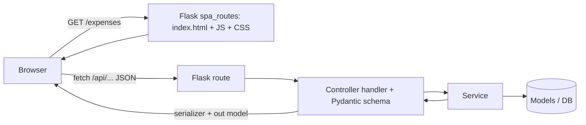
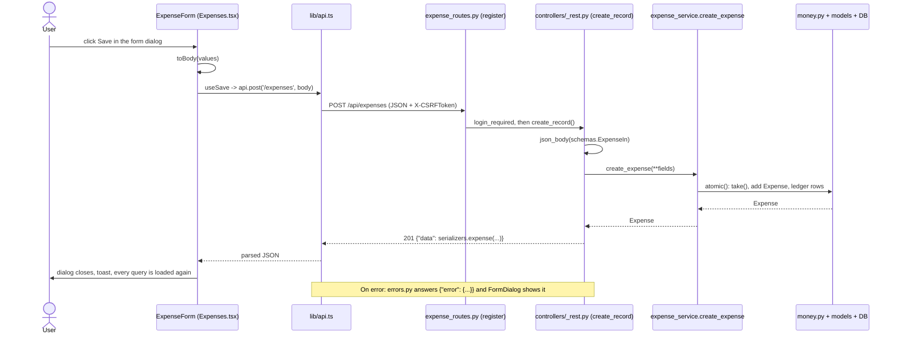

# Be Aware: maintenance and architecture guide

This guide describes the code as it is today. Where something could not be confirmed from the source, it says so. File paths are relative to the project root (the folder that contains `run.py`).

## 1. Project overview

**Purpose.** Be Aware is a single-user personal finance tracker. It records expenses, incomes, withdrawals, deposits, loans, debts, bank transfers and credit card payments, keeps the balances of bank accounts and credit cards in step with them, and keeps three ledgers (cash, bank account, credit card). The home page shows totals and yearly charts.

**Technologies**

| Layer | What is used (from `requirements/requirements.txt` and the code) |
|---|---|
| Backend | Python, Flask, Flask-SQLAlchemy, Flask-Login, Flask-WTF (CSRF), Flask-Limiter, Flask-Migrate, Flask-Babel, Pydantic (request validation), bcrypt |
| Database | SQLite for development and tests, MySQL for production (`app/config.py`) |
| Frontend | React 19 + TypeScript, built with Vite (`frontend/`); React Router, TanStack Query, Chart.js, Lucide icons |
| Styling | Tailwind CSS 3.4 (`frontend/src/app.css`, `frontend/tailwind.config.js`) |
| API description | OpenAPI 3.1 generated from the code (`backend/app/openapi.py`); TypeScript types are generated from it |

**Architecture in one paragraph.** Two programs in one repository. `backend/` is a Flask app that only speaks JSON under `/api`. `frontend/` is a React app; `npm run build` puts its files in `backend/app/static/app`, and Flask answers every other URL (`/`, `/expenses`, `/loans/3`, ...) with that app's `index.html` (`app/routes/spa_routes.py`). React Router draws the page and the page calls `/api` with `fetch`. All saving, editing and deleting goes through `/api` as JSON. During development `npm run dev` serves the React app on port 5173 and forwards `/api` to Flask on port 5000.



Backend layering is always `route -> controller -> service -> model`. Tailwind is part of the Vite build: it scans `frontend/src` for class names.

**Legacy notes (verified by searching the code).** The project was refactored, and some old code is still present:

- `to_dict()` on the models (for example `app/models/expense.py`) is no longer what JSON responses use; the controllers use `app/controllers/serializers.py`. `to_dict()` is still called by `app/services/associations.py` (`group_by_table`) and by a few `associated_records` helpers.
- No caller was found, in `app/` or `tests/`, for these functions (searched by name; dynamic use cannot be ruled out): `associated_records_page` and `associated_records` in `app/services/bank_account_service.py`, `associated_records` in `app/services/credit_card_service.py`, `app/services/loan_service.py` and `app/services/debt_service.py`, `get_data_as_dictionary` in `app/utils/parse_structures.py`, and `is_decimal_type` in `app/utils/numeric_casting.py`. `expense_category_service.associated_records` is still called by `records_of` in `app/controllers/expense_category_controller.py`, only to produce a 404 for a deleted category.
- Some file and blueprint names do not match the URLs any more: `app/routes/banktransfer_routes.py` serves `/api/bank_transfers`, `app/routes/cashledger_routes.py` serves `/cash_ledger`, `app/routes/bank_transaction_ledger_routes.py` serves `/bank_ledger`, `app/routes/credit_card_transaction_routes.py` serves `/card_ledger`.
- Spelling quirks that are part of the code: the CSRF extension is called `crsf` in `app/extensions.py`, `generate_montly_sequence` in `app/utils/code_generator.py`, and the user-facing message `Insufficient founds.` in `app/services/money.py`.

## 2. Project directory structure

```
be_aware/
├── backend/                     the Flask app. Paths like app/... in this guide are inside backend/. Run flask, pytest and pip here
│   ├── run.py, wsgi.py              entry points: both call create_app()
│   ├── pytest.ini                   testpaths = tests
│   ├── requirements/                requirements.txt, requirements-dev.txt
│   ├── app/
│   │   ├── __init__.py              create_app(), extension setup, blueprint registration, error log files
│   │   ├── config.py                Config, DevelopmentConfig, TestingConfig, ProductionConfig, get_config()
│   │   ├── extensions.py            db, babel, limiter, login_manager, crsf (CSRFProtect)
│   │   ├── cli.py                   `flask init-db`, `flask seed-db`
│   │   ├── errors.py                one JSON error format + handlers + unauthorized()
│   │   ├── routes/                  URL -> handler. One <module>_routes.py per module; _rest.py has register() and get()
│   │   ├── controllers/             request -> service call -> JSON. _rest.py (Resource, handlers), schemas.py, serializers.py
│   │   ├── services/                business rules, no Flask: <module>_service.py, money.py, search.py, ledger_service.py, stats_service.py
│   │   ├── models/                  SQLAlchemy models, one file per table; __init__.py imports them all
│   │   ├── exceptions/              domain exceptions (bankProductsException.py, records.py, generic.py)
│   │   ├── utils/                   transactions.py (atomic), times.py, date_handling.py, code_generator.py, filter_data.py, auth.py, db.py
│   │   └── static/app/              the React build (generated, not committed)
│   ├── tests/                       pytest suite: conftest.py, helpers.py, test_*.py
│   └── (also here: migrations/, scripts/export_openapi.py, and at runtime instance/ and logs/)
├── frontend/                    React + TypeScript app: src/ (pages, components, lib, types), openapi.json, package.json, vite.config.ts, tailwind.config.js
├── prototypes/                  a design prototype, not part of the app (not inspected)
├── README.md                    setup and URL summary
└── MAINTENANCE_GUIDE.md         this file
```

Created at runtime and not part of the source: `backend/instance/` (the development SQLite file `be_aware_dev.db`), `logs/` (`error.log`, `app.log`, written by `create_error_logger` in `app/__init__.py` unless `LOG_TO_FILES` is false). The `.gitignore` file was not inspected for this guide.

## 3. Backend architecture

### 3.1 Startup and configuration

- `run.py` and `wsgi.py` call `create_app()` (`app/__init__.py`). `create_app(config_name=None)` calls `get_config()`, loads the config object, creates `instance/`, wraps the app in `ProxyFix`, then calls `register_extensions(app)`, `register_resources(app)`, `register_cli(app)` and `create_error_logger(app)`.
- `get_config()` in `app/config.py` picks the class from the `APP_ENV` variable (`development` by default, `testing`, `production`). Other variables read: `SECRET_KEY`, `DEV_DATABASE_URL`, `TEST_DATABASE_URL`, `NAV_BAR_BACKGROUND_COLOR`. A `.env` file is loaded with `load_dotenv()`.
- Development uses `instance/be_aware_dev.db` (SQLite). `TestingConfig` uses in-memory SQLite and turns off rate limiting and CSRF. `ProductionConfig.SQLALCHEMY_DATABASE_URI` imports `db_url` from `app/utils/db.py` (MySQL connection built from `.env`). Earlier analysis of this project flagged credentials in the git history (commit `3d66a65`); that cannot be verified from the working tree.
- `inject_theme` (context processor in `create_app`) gives every template `env_name`, `env_label` (the DEV/TEST/PROD badge) and `nav_bar_backgroud`.
- `Migrate(app, db)` is created in `register_extensions`, but **no `migrations/` directory exists in the project**, so schema changes are not managed by migrations (see 8.1).

### 3.2 Blueprints and routes

Each module has one blueprint in `app/routes/<module>_routes.py`, registered in `register_resources` (`app/__init__.py`). The blueprints have no `url_prefix`; every rule is written in full.

- **There are no page routes.** Pages belong to the React app; `app/routes/spa_routes.py` answers every non-API URL with its `index.html`.
- **JSON** is registered with two helpers in `app/routes/_rest.py`:
  - `register(blueprint, resource, path)` adds `GET/POST /api<path>` and `GET/PUT/DELETE /api<path>/<id>`, only for the verbs the `Resource` supports.
  - `get(blueprint, path, view, name)` adds one read-only `GET /api<path>` (used for reports, records and payments).
  - Both wrap the view in `login_required`.
- Auth routes are in `app/routes/auth_routes.py` (`POST /api/login`, `POST /api/logout`, `GET /api/session`). `app/routes/home_routes.py` serves `/api/dashboard` and `/api/options`. `app/routes/stats_routes.py` serves `/api/reports/...`.

To list every route: `flask routes` (or print `app.url_map`), or open `/api/docs` (development).

### 3.3 Controllers (`app/controllers`)

A controller module declares a `RESOURCE = Resource(...)` (dataclass in `app/controllers/_rest.py`): the model, the serializer function, the create/update schemas, the service functions (`create`, `update`, `delete`), `default_list` (what `GET /api/x` returns with no filter), `filter` (used when `q`, or both `start` and `end`, are given) and `list_meta` (extra values for `meta`). `handlers(resource)` builds the five view functions `list_records`, `create_record`, `read_record`, `update_record`, `delete_record`, so most modules need no hand-written HTTP code. Modules with extras add plain functions, for example `records_of`, `yearly_report` in `app/controllers/bank_account_controller.py`, `payments_of` in `app/controllers/loan_controller.py`.

Other files: `app/controllers/schemas.py` (Pydantic request models), `app/controllers/serializers.py` (response shapes), `app/controllers/home_controller.py` (`dashboard`, `options`), `app/controllers/stats_controller.py` (reports), `app/controllers/auth_controller.py` (`login`, `logout`, `session_info`), `app/controllers/cashledger_controller.py` (the three ledgers: `CASH`, `BANK`, `CARD`).

### 3.4 Services (`app/services`)

Business rules live here. Services take plain keyword arguments (note the `*` in signatures such as `create_expense(*, amount, is_cash, ...)`), return model objects, and know nothing about Flask. Every function that moves money runs inside `with atomic():` (`app/utils/transactions.py`), so the record, the balance change and the ledger rows are committed together or rolled back together.

| File | Responsibility |
|---|---|
| `app/services/money.py` | `validate_amount`, `get_record` (raises `RecordNotFound`), `get_bank_account`, `get_credit_card`, `take` / `give` (move money, refuse to go below zero). Never commits |
| `app/services/<module>_service.py` | `create_*`, `update_*`, `delete_*`, list and filter functions for one module (expense, income, withdrawal, deposit, loan, debt, loan_payment, debt_payment, banktransfer, credit_card_payment, bank, bank_account, credit_card, expense_category) |
| `app/services/search.py` | `SearchSpec` plus `search`, `between_dates`, `filter_all`: the one implementation of the search box and date range on every list |
| `app/services/ledger_service.py` | reading the ledgers, cash adjustments (`create_cash_adjustment`, `delete_cash_adjustment`), `cash_balance` |
| `app/services/stats_service.py`, `app/services/home_service.py` | totals and yearly or monthly series for the charts and the home page |
| `app/services/obligations.py` | shared logic for loans and debts |

### 3.5 Models and data access (`app/models`)

One file per table, using `db.Model` from `app/extensions.py`. `app/models/__init__.py` imports every module in the folder automatically, so a new model file is picked up without registering it. Data access is SQLAlchemy queries inside the services (`Model.query...`, `db.session.get(...)`), plus helpers in `app/utils/filter_data.py` and `app/utils/bank_accounts/filter_data.py` for yearly and monthly totals. Examples to read: `app/models/expense.py` (the `before_flush` listener `assign_code` fills `code` using `generate_montly_sequence` from `app/utils/code_generator.py`), and the ledger models `app/models/cash_ledger.py`, `app/models/bank_account_transactions_ledger.py`, `app/models/credit_card_transactions_ledger.py`, which the money services write to.

Dates: expenses and incomes are stored as local wall-clock time, every other record as UTC. `app/utils/times.py` (`to_local_iso`, `from_client`) hides this at the controller boundary; `Resource.stored_as_utc` is `False` for expenses and incomes (set in `app/controllers/expense_controller.py` and `app/controllers/income_controller.py`).

### 3.6 Authentication and authorization

- Flask-Login. The `User` model is `app/models/user.py` (`username`, `password` stored as a bcrypt hash). `verify_password` is in `app/utils/auth.py`; `load_user` is defined in `register_extensions`.
- `login` in `app/controllers/auth_controller.py` validates `LoginIn`, checks the password and calls `login_user`. The login route is rate limited (`@limiter.limit('20 per hour;60 per minute')` in `app/routes/auth_routes.py`); the global default is `600 per minute` (`register_extensions`).
- Every JSON route is protected by `login_required`, except `POST /api/login` and `GET /api/session`. The React shell itself is public; its `RequireAuth` component asks `GET /api/session` and sends anyone who is not logged in to `/login`.
- CSRF: `crsf` (`CSRFProtect`). The token comes from `GET /api/session`; `frontend/src/lib/api.ts` sends it in the `X-CSRFToken` header and fetches a new one once if the server says it expired.
- **There are no roles or permissions, and no model has a `user_id`**: the app is effectively single-user. Any logged-in user sees all data.
- `unauthorized()` in `app/errors.py` answers 401 `not_authenticated`; the React app reacts by showing the login form.

### 3.7 Errors and validation

- Request validation is Pydantic: `json_body(schema, ...)` in `app/controllers/_rest.py` calls `schema.model_validate(payload)`. The schemas are in `app/controllers/schemas.py` and ignore unknown fields (`extra='ignore'` in `Body`).
- `app/errors.py` (`register_error_handlers`) turns every failure into `{"error": {"code", "message", "fields"?}}`:

| Cause | Status | `code` |
|---|---|---|
| Pydantic `ValidationError` | 422 | `validation_error` (with `fields`) |
| `RecordNotFound` | 404 | `not_found` |
| Domain exceptions from `app/exceptions` (for example `AmountGreaterThanAvailableMoney`) | 400 | the class name in snake_case, for example `amount_greater_than_available_money` |
| `ValueError` (bad `year`, bad dates, body not a JSON object) | 400 | `invalid_value` |
| `CSRFError` | 400 | `csrf_failed` |
| not logged in | 401 | `not_authenticated` |
| anything else | 500 | `server_error` |

- `wants_json()` decides JSON or HTML errors: anything under `/api/`, any request that is not GET or HEAD, or one that sends or accepts JSON gets JSON. A person opening a page gets the normal HTML error pages.
- Business rules signal failure by raising exceptions from `app/exceptions` (for example `NoBankProductSelected`, `NoAvailableMoney`); the message is written for the person and is shown as is.

### 3.8 JSON conventions

- Success: `{"data": ...}`. Lists: `{"data": [...], "meta": {"count": n, "total": "12.50", ...}}`. Create answers 201, delete answers 204 with no body.
- Money is always a string with two decimals (`money()` in `app/controllers/serializers.py`).
- `created_at` and `updated_at` are local wall-clock ISO text without an offset (`2026-10-30T12:00:00`). On write, `created_at` is optional and defaults to now.
- A related record contributes its id and its readable name (`bank_account_id`, `bank_account_name`).
- List endpoints accept `?q=text` and `?start=YYYY-MM-DD&end=YYYY-MM-DD` (both dates or none, otherwise 422). Reports accept `?year=` (`year_param` in `app/controllers/_rest.py`).

## 4. Frontend architecture

The frontend is `frontend/`, a Vite project. Run `npm install` once, then `npm run dev` (port 5173, forwards `/api` to Flask) or `npm run build` (writes `backend/app/static/app`, which Flask serves).

### 4.1 Structure

```
frontend/src/
├── main.tsx              router, providers, one <Route> per page
├── app.css               Tailwind layers and the component classes (.btn, .card, .table, .tag, ...)
├── pages/                one file per page: Home, Expenses, Incomes, Obligations (loans and debts), Details, ...
├── components/
│   ├── Layout.tsx        navbar, phone drawer, theme switch, logout
│   ├── Providers.tsx     theme, toasts (useToast) and the "Are you sure?" dialog (useConfirm)
│   ├── Dialog.tsx, Icon.tsx, RequireAuth.tsx
│   ├── ui/page.tsx       PageHeader, StatRow, Tile, totalStat
│   ├── ui/table.tsx      TableCard (search bar, table, empty state, total line), RowActions, FilterBar
│   ├── ui/form.tsx       FormDialog and the fields (AmountField, DateField, TextField, SelectField, MethodField, SwitchField)
│   ├── ui/records.tsx    RecordsTabs: the records of an account, card or category, one tab per kind
│   ├── forms/shared.tsx  forms several pages use: TransferForm, CardPaymentForm, PaymentForm
│   └── charts/           draw.ts (Chart.js with the app's look), YearlyChart, ReportChart
├── lib/
│   ├── api.ts            fetch wrapper: JSON, CSRF, one ApiError type
│   ├── queries.ts        useList, useReport, useOptions, useSave, useRemove, usePageTitle
│   ├── crud.ts           useCrud (what every list page does) and useOpenRow (double click on a row)
│   ├── format.ts         money, dates, titleCase, filterRows, ...
│   └── nav.ts            the menu (GROUPS) and which entry a URL belongs to
└── types/                api.ts is GENERATED from the OpenAPI document; index.ts gives its types friendly names
```

### 4.2 How a page is built

`src/pages/Incomes.tsx` is the smallest complete example:

1. `useCrud<Income>({ path: '/incomes', noun: 'income' })` loads the list, keeps the search state, tracks which record the form is editing (`editing` is a record, `'new'` or `null`) and asks before deleting (`onDelete`).
2. `PageHeader`, `StatRow` and `TableCard` draw the frame; the page writes its own `<tr>` for each row, using `RowActions` for the edit and delete buttons.
3. A form component (`IncomeForm`) holds the values as text, builds the JSON in `submit()`, calls `useSave('/incomes')` and shows a toast. `FormDialog` shows the server's messages: one that names a field goes under that field, any other goes in the banner at the top.
4. `YearlyChart` draws the "per month" card.

One rule keeps the data fresh: after any save or delete, every query is loaded again (`invalidateQueries()` in `useSave` and `useRemove`). No page refreshes its lists by hand.

Two pages are shared by two modules: `Obligations.tsx` (loans and debts, configured by the `LOANS` and `DEBTS` objects) and `CashMovements.tsx` (withdrawals and deposits).

### 4.3 Tailwind and styling

- Utility classes are written in the components. The shared look is defined as component classes in `frontend/src/app.css` under `@layer components`: `.btn`, `.btn-primary`, `.btn-outline`, `.btn-icon`, `.input`, `.select`, `.card`, `.table`, `.tag`, `.segmented`, `.switch`, `dialog.modal`, and others.
- Colors are CSS variables (`--canvas`, `--surface`, `--ink`, `--muted`, ...) with a light and a dark set (`:root[data-theme='dark']`); `frontend/tailwind.config.js` maps them to Tailwind color names (`bg-surface`, `text-muted`, `text-negative`, `module`, ...). Each module has a color token (`--m-expenses`, `--m-loans`, ...) selected by `body[data-module]`, which `Layout.tsx` sets from the menu entry of the current URL.
- Tailwind only keeps classes it finds as whole strings in `frontend/index.html` and `frontend/src/**/*.{ts,tsx}`. Class names assembled from pieces at runtime are not detected.
- The theme (light or dark) is chosen before the first paint by the script in `frontend/index.html` and stored in `localStorage`.

### 4.4 Which file to edit

| You want to change | Edit |
|---|---|
| Columns, buttons, labels or layout of one page | `frontend/src/pages/<Page>.tsx` |
| How every table, stat card, filter bar or form field looks | `frontend/src/components/ui/*.tsx` |
| A dialog used by several pages | `frontend/src/components/forms/shared.tsx` |
| Loading, saving and deleting in general | `frontend/src/lib/queries.ts`, `frontend/src/lib/crud.ts`, `frontend/src/lib/api.ts` |
| Colors, buttons, spacing for the whole app | `frontend/src/app.css`, `frontend/tailwind.config.js` |
| Navbar, menu groups, page frame | `frontend/src/components/Layout.tsx`, `frontend/src/lib/nav.ts` |
| Chart look | `frontend/src/components/charts/draw.ts` |
| Which columns the tabs of an account, card or category show | `KINDS` in `frontend/src/components/ui/records.tsx` |

## 5. Frontend-backend communication

### 5.1 The flow

1. **Sending.** All requests go through the `api` object in `frontend/src/lib/api.ts` (`api.get`, `api.post`, `api.put`, `api.delete`). It prefixes `/api`, so pages write `api.get('/expenses')`. For writes it adds `Content-Type: application/json` and the `X-CSRFToken` header (token from `GET /api/session`).
2. **Receiving.** The route (registered by `register()` in `app/routes/_rest.py`) calls a handler from `handlers()` in `app/controllers/_rest.py`. `json_body()` validates the body with the Pydantic schema and passes it as keyword arguments to the service.
3. **Responding.** The handler serializes the result with the function in `app/controllers/serializers.py`, checks it against the response model in `app/controllers/out.py` (`Resource.present()`) and returns `{"data": ...}`. Errors are produced by `app/errors.py`.
4. **Handling.** `request()` in `api.ts` returns the parsed JSON on success. On failure it throws `ApiError` (`status`, `code`, `message`, `fields`). A `csrf_failed` error fetches a fresh token and retries once; a network failure becomes an `ApiError` with code `network_error`; a 401 makes `main.tsx` ask the session again, and `RequireAuth` then shows the login form.
5. **Showing the result.** In a form, `FormDialog` catches the `ApiError`: messages for fields on screen appear under the input, anything else in the banner at the top of the dialog. Elsewhere (loading a list, deleting) `toastError` shows a toast. Successful saves and deletes show `toast(...)`.

**Loading states.** A list keeps showing its previous rows while a new search loads (`keepPreviousData`), and TanStack Query drops an older answer when a newer one arrives. During a save the submit button is disabled.

**Client-side validation.** Forms use `noValidate`, so the browser's own checks do not run; validation happens on the server and its messages come back in `fields`.

**Types.** The shapes of the answers come from the OpenAPI document: `frontend/src/types/api.ts` is generated by `npm run gen:api` and must not be edited by hand. A test (`test_the_exported_file_is_up_to_date`) fails when the backend changed and the file was not regenerated.

### 5.2 Example A: GET (list of expenses)

| Item | Where |
|---|---|
| Page | `frontend/src/pages/Expenses.tsx` (`useCrud({ path: '/expenses', ... })`) |
| Request | `GET /api/expenses?start=2026-10-01&end=2026-10-31` (with no filter, the current month) |
| Route | `register(expense_bp, controller.RESOURCE, '/expenses')` in `app/routes/expense_routes.py` (endpoint `expense.record_list`) |
| Handler | `list_records` in `app/controllers/_rest.py` |
| Service | `expense_service.filter_expenses` (when `q` or both dates are given) or `expense_service.get_monthly_expenses_records` (default), in `app/services/expense_service.py` |
| Extra meta | `_budget` in `app/controllers/expense_controller.py` (uses `expense_service.money_limit_spent_left`) |
| Serializer | `serializers.expense` |

Response (real output from the test client):

```json
{
  "data": [{
    "id": 1, "code": "EXP_2026_10_76210", "amount": "12.50", "is_cash": false,
    "description": "Lunch", "expense_category_id": 1, "expense_category_name": "Food",
    "bank_account_id": 1, "bank_account_name": "Checking",
    "credit_card_id": null, "credit_card_name": null,
    "created_at": "2026-10-30T12:00:00", "updated_at": null
  }],
  "meta": { "count": 1, "total": "12.50",
            "budget": { "limit": "300.00", "spent": "12.50", "left": "287.50" } }
}
```

`Expenses.tsx` reads `meta` and shows the four figures above the table with `StatRow`.

### 5.3 Example B: POST (create an expense)

| Item | Where |
|---|---|
| Page | `frontend/src/pages/Expenses.tsx`: `ExpenseForm` with `toBody` (builds the JSON) and `useSave('/expenses')` |
| Request | `POST /api/expenses` with the JSON below |
| Route | same `register(...)` call as above (endpoint `expense.record_create`) |
| Handler | `create_record` in `app/controllers/_rest.py` -> `json_body(schemas.ExpenseIn, stored_as_utc=False)` |
| Service | `create_expense` in `app/services/expense_service.py` |
| What the service does | `money.validate_amount`, `_products_for`, then inside `atomic()`: `money.take` on the account or card, insert the `Expense`, then `CashLedger.create`, `BankAccountTransactionsLedger.create`, `CreditCardTransactionsLedger.create` as needed |

```json
{ "amount": "12.50", "description": "Lunch", "created_at": "2026-10-30T12:00",
  "expense_category_id": 1, "is_cash": false, "bank_account_id": 1, "credit_card_id": null }
```

Success: `201` with `{"data": <the expense, as in example A>}`. Then the page shows a toast, closes the form and every query is loaded again, so the list, the figures and the chart update.

Errors (real output):

```json
// 400, the service refused (money.take raised AmountGreaterThanAvailableMoney)
{ "error": { "code": "amount_greater_than_available_money", "message": "Insufficient founds." } }

// 422, schema validation (description is empty)
{ "error": { "code": "validation_error", "message": "description: This field is required.",
             "fields": { "description": "This field is required." } } }
```

The 422 shows under the Description input; the 400 has no matching field, so `FormDialog` puts it in the banner at the top of the dialog.

## 6. Data flow

Creating an expense from the page:



## 7. Maintenance guide: where to make changes

| Maintenance task | Where to look | What to change | Important considerations |
|---|---|---|---|
| Add or change a form field | `frontend/src/pages/<Page>.tsx` (the field inside the form component, its `Values`, `fromRecord` and `toBody`), `app/controllers/schemas.py`, `app/controllers/out.py`, the `create_*` and `update_*` functions in `app/services/<module>_service.py`, `app/controllers/serializers.py`, `app/models/<module>.py` | Add the input, send it in `toBody`, accept it in the schema and the service, return it from the serializer and the `Out` model, store it in the model, run `npm run gen:api` | The schema ignores unknown fields (`extra='ignore'`), so a field missing from the schema is dropped silently. The field `name` must match everywhere. A new database column needs a schema change (see 8.1) |
| Change frontend validation | `frontend/src/components/ui/form.tsx`, the form component of the page | Forms use `noValidate`; add checks at the start of `submit()` of the form component (before the request) | There is no client-side validation today. Keep the server rule as well, since the API can be called without the page |
| Change backend validation | `app/controllers/schemas.py` (types, lengths), `app/services/money.py` (`validate_amount`), the `_validate_*` and `_products_for` helpers in the services | Edit the Pydantic model or raise an exception from `app/exceptions` | Pydantic errors become 422 with `fields`; domain exceptions become 400 with the class name as `code`. Messages are shown to the person as written |
| Modify a business rule | `app/services/<module>_service.py`, `app/services/money.py` | Change the service function | Keep writes inside `with atomic():`. Update, delete and create must stay symmetric (for example `_refund` in `expense_service.py`). Add or adjust a test in `tests/test_*_flows.py` |
| Add or modify a JSON endpoint | `app/routes/<module>_routes.py`, `app/routes/_rest.py`, `app/controllers/<module>_controller.py`, service | CRUD: edit the `Resource` in the controller. Read-only extra: add a controller function returning `data(...)` and a line with `get(blueprint, path, view, name)` | URLs are `/api/<plural_snake_case>`. The frontend writes the path without `/api` (`lib/api.ts` adds it). Add a test using the `client` fixture |
| Change a JSON response structure | `app/controllers/serializers.py` (record shape), the controller's `list_meta` function (`meta`) | Edit the serializer function | Then update the `Out` model in `app/controllers/out.py`, run `npm run gen:api`, and fix what TypeScript then reports (`npm run typecheck`). Search the key name in `frontend/src` and in `tests/` |
| Update a table, list or dashboard | `frontend/src/pages/<Page>.tsx` (`headers` of `TableCard` and the `<td>` in the row); home: `frontend/src/pages/Home.tsx` | Add the header and the cell | Header classes (`hidden sm:table-cell`) must match the cell classes. React escapes the values, so text typed by a person can never run as HTML |
| Modify a modal or reusable component | `frontend/src/components/ui/form.tsx` (`FormDialog`, fields), `components/forms/shared.tsx`, `components/Providers.tsx` (confirm dialog), `components/Dialog.tsx` | Edit the component | One change affects every page that uses it. Run `npm test`, `npm run typecheck` and open a few pages |
| Change Tailwind styling | `frontend/src/app.css`, `frontend/tailwind.config.js`, class names in the components | Edit; `npm run dev` shows it at once, `npm run build` makes the files Flask serves | Dark mode values are in `:root[data-theme='dark']` |
| Add a new page or module | model in `app/models/`, service in `app/services/`, schema, serializer and `Out` model, controller in `app/controllers/`, route in `app/routes/`, blueprint in `register_resources` (`app/__init__.py`); then `npm run gen:api`, a page in `frontend/src/pages/`, a `<Route>` in `frontend/src/main.tsx`, a menu entry in `frontend/src/lib/nav.ts` | Copy the closest existing module (`income` is the simplest, `Incomes.tsx` its page) | A new menu `key` also needs a `--m-<key>` color in `frontend/src/app.css` and a `[data-module=...]` rule |
| Modify database models or queries | `app/models/<module>.py`, queries in `app/services/<module>_service.py`, `app/services/search.py` (`SearchSpec`), `app/utils/filter_data.py` | Edit the model or query | No migrations exist (see 8.1). Money columns are `Numeric(10,2)`. Test on SQLite and keep MySQL in mind (production) |
| Change authentication or permissions | `app/routes/auth_routes.py`, `app/controllers/auth_controller.py`, `app/utils/auth.py`, `app/models/user.py`, `login_manager` setup in `register_extensions`, `unauthorized` in `app/errors.py`, `frontend/src/pages/Login.tsx`, `frontend/src/components/RequireAuth.tsx` | Edit the login flow | There are no roles; multi-user support would need a `user_id` on the models and filters in every service (not implemented). New routes must be wrapped in `login_required` (done by `register()` and `get()`) |

## 8. End-to-end change examples

These are walk-throughs. The names they add (`notes`, `/summary`) do not exist in the code.

### 8.1 Add a "notes" field to expenses

1. **Model.** `app/models/expense.py`: add `notes = db.Column(db.String(255))`. There is no `migrations/` folder, and `flask init-db` (`db.create_all()`) does not alter a table that already exists, so an existing database needs a manual `ALTER TABLE` (or Flask-Migrate would have to be set up first: `Migrate` is initialized but unused as far as could be verified). A fresh test database picks the column up automatically.
2. **Schema.** `app/controllers/schemas.py`, `ExpenseIn`: add `notes: Optional[str] = Field(default=None, max_length=255)`.
3. **Service.** `create_expense` and `update_expense` in `app/services/expense_service.py`: add a keyword argument `notes=None` and assign it on the `Expense`. (The schema's fields are passed to the service as keyword arguments, so the names must match.)
4. **Serializer.** `expense(e)` in `app/controllers/serializers.py`: add `'notes': e.notes`.
5. **Response model.** `ExpenseOut` in `app/controllers/out.py`: add `notes: Optional[str]`, then run `npm run gen:api` in `frontend/` so the TypeScript type has it.
6. **Page.** `frontend/src/pages/Expenses.tsx`: add `notes` to `Values`, to `fromRecord` (`r.notes ?? ''`), to the initial values and to `toBody` (`v.notes || null`), and a `<TextField name="notes" label="Notes" optional ... />` in `ExpenseForm`.
7. **Test.** `tests/test_expense_money_flows.py` (uses `tests/helpers.py`): create an expense with `notes` and check it comes back.

### 8.2 Add a read-only endpoint

Example: `GET /api/expenses/summary`.

1. **Service.** Add the calculation in `app/services/expense_service.py` (plain arguments, return a dict or Decimal).
2. **Controller.** `app/controllers/expense_controller.py`: add `def summary(): return data({...})` (`data` is in `app/controllers/_rest.py`); format money with `money()` from `app/controllers/serializers.py`; use `year_param()` if it takes `?year=`.
3. **Route.** `app/routes/expense_routes.py`: `from app.routes._rest import get, register` and `get(expense_bp, '/expenses/summary', controller.summary, 'summary')`. (`get` adds the `/api` prefix and `login_required`.)
4. **Frontend.** Add a response model in `app/controllers/out.py` and pass it as `out=` in the `get(...)` call, run `npm run gen:api`, then in a page: `const summary = useReport<Summary>('/expenses/summary')`. Errors arrive as `ApiError`; use `toastError`.
5. **Test.** A test using the `client` fixture from `tests/conftest.py` that calls `/api/expenses/summary` and checks `response.get_json()['data']`.

### 8.3 Change how a page looks without touching logic

Example: show the expense category as plain text instead of a tag on the Expenses page.

1. Edit only `frontend/src/pages/Expenses.tsx`: in the `<tr>`, change `<span className="tag">{row.expense_category_name || '–'}</span>` to a plain `<span>`.
2. Run `npm run dev` and look at the page (Tailwind picks up new classes by itself).
3. Do not touch the form, the controller or the service: the JSON stays the same.
4. Check the page at a phone width (columns marked `hidden sm:table-cell` disappear there) and in dark mode.

## 9. Troubleshooting

| Problem | Where to look | Approach |
|---|---|---|
| A JSON request returns an error | `app/errors.py`, `app/controllers/_rest.py` (`json_body`), `app/controllers/schemas.py`, the service, browser DevTools Network tab | Read `error.code` and `error.message` in the response. `validation_error` (422): see `fields`. A code that is a snake_case class name (400): find it in `app/exceptions` and the service that raises it. `not_found` (404): wrong id or `get_record`. `csrf_failed`: the token header is missing. `server_error` (500): read `logs/error.log` (development) or the Flask console. To reproduce, call the endpoint with the `client` fixture in a test |
| A frontend component does not update | `frontend/src/pages/<Page>.tsx`, `frontend/src/lib/queries.ts` | Open the console for errors; confirm the request went to `/api/...` and returned `{data, meta}`. After a save everything is loaded again (`invalidateQueries()` in `useSave`/`useRemove`); a page that talks to the server some other way would miss that. If Flask serves an old build, run `npm run build` again and hard reload |
| A form submits incorrect data | `toBody` and `fromRecord` in `frontend/src/pages/<Page>.tsx` | Look at the request payload in the Network tab. Fields of an option that is not chosen are left out of the form (`values.method === 'bank' && ...`) and sent as `null` by `toBody`. Empty strings must be turned into `null` in `toBody` (`v.description || null`, `idOrNull`) |
| A page renders incorrectly | `frontend/src/pages/<Page>.tsx`, `frontend/src/components/ui/*.tsx`, `frontend/src/app.css` | The browser console shows React errors. A blank page after `flask run` usually means the build is missing: `cd frontend && npm run build`. For layout problems check classes in the row against the `headers` of `TableCard` |
| A database operation fails | the service, `app/utils/transactions.py` (`atomic`), `app/models`, `app/config.py` | `atomic()` rolls back and re-raises, so the original exception is the cause. Check the database in use (`APP_ENV`, `instance/be_aware_dev.db`). A "no such column" or "no such table" error means the schema is out of date (no migrations; see 8.1). `flask init-db` creates missing tables only |
| A user cannot access a page or endpoint | `app/routes/auth_routes.py`, `app/controllers/auth_controller.py`, `unauthorized` in `app/errors.py`, `register_extensions` in `app/__init__.py` | A JSON 401 `not_authenticated` means no valid session; the React app shows `/login`. Wrong password: 401 `wrong_credentials`. Too many attempts: 429 (Flask-Limiter, see `app/routes/auth_routes.py`). No user exists yet: run `flask seed-db`. `SECRET_KEY` must stay the same, or sessions are invalidated |

Useful commands: from `backend/`: `pytest` (all tests), `flask db upgrade`, `flask seed-db`, `flask run`. From `frontend/`: `npm run dev`, `npm run build`, `npm test`, `npm run typecheck`, `npm run gen:api`.

## 10. Development conventions already in use

- **Naming.** Modules and URLs are snake_case and plural (`/api/bank_accounts`, `/api/credit_card_payments`). Python functions are snake_case; service functions are named by action (`create_expense`, `update_expense`, `delete_expense`).
- **Layering.** Route, controller and service each do one job. Routes contain no logic. Controllers contain no business rules. Services contain no Flask code.
- **One `RESOURCE` per controller module** (a `Resource`), plus plain functions for extras. Ledgers use `CASH`, `BANK`, `CARD` in `app/controllers/cashledger_controller.py`.
- **Services** take keyword-only arguments, return model objects, and wrap money writes in `with atomic():`. They raise exceptions from `app/exceptions` with messages meant for the person.
- **JSON.** `{"data": ...}` and `{"data": [...], "meta": {...}}` for success; `{"error": {"code", "message", "fields"?}}` for failure. Money as two-decimal strings. Dates as local ISO text. `created_at` optional on write. 201 for create, 204 for delete.
- **Tests.** `tests/conftest.py` provides `app`, `db`, `data` (a bank, two accounts, two cards, two categories and a user) and `client` (logged in). Tests call the real URLs. The React shell is tested in `tests/test_spa.py`, the OpenAPI document in `tests/test_openapi.py`.
- **Frontend.**
  - One file per page in `frontend/src/pages`; a page that two modules share takes a small config object (`LOANS`, `DEBTS`).
  - Lists load through `useCrud` / `useList`, writes through `useSave` / `useRemove`; nothing refreshes a list by hand.
  - The shapes of the API come from `frontend/src/types/api.ts` (generated); `types/index.ts` only renames them.
  - Values from the server are rendered as React text, never as HTML.
  - Dialogs are native `<dialog>` elements (`components/Dialog.tsx`).
  - Interface text is in English.
- **Styling.** Tailwind utilities in the components, shared look as component classes in `frontend/src/app.css`, colors from CSS variables. The build output is not committed.

## 11. The OpenAPI document

- `app/controllers/out.py` has one Pydantic model per response. `Resource.present()` validates every record against its model before it is sent, so a response that does not fit fails in tests instead of silently changing the API.
- `app/openapi.py` builds the document from `app.url_map`, the request schemas, the response models and what `register()` / `get()` in `app/routes/_rest.py` record. `GET /api/openapi.json` and `GET /api/docs` exist while `OPENAPI_ENABLED` is true (development and tests).
- `python scripts/export_openapi.py` (from `backend/`, run by `npm run gen:api`) writes `frontend/openapi.json`, and `openapi-typescript` turns it into `frontend/src/types/api.ts`. Commit both after changing the API.
- To describe a new endpoint: add its response model to `out.py`, pass `out=` (and `many=True`, `query=`) to `get()`, run `npm run gen:api`, and remove it from `NOT_TYPED_YET` in `backend/tests/test_openapi.py`. The endpoints left in that list are not used by any page yet.
- `GET /api/session` also returns `env_name` and `env_label`, which the navbar shows as the DEV / TEST badge.
